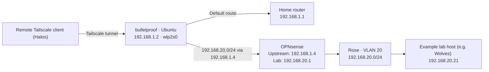

# Routing my Tailscale traffic into the Rose lab
> Note a lot of this information I was already aware of (since obviously I run my homelab so I didn't *really* need to confirm IPs and OS info, **but** this might be useful to use / know for those who might want to replicate a similar setup without having to look up some commands or info and can just read this directly.

I have an existing Tailscale device on the home network that previously also functioned as a subnet router, but because my network was flat, it was much easier to just advertise the hosts I wanted to remotely access.

Bulletproof had previously served as a subnet router. After the move, I needed to give it a route to the lab through OPNsense before it could forward Tailscale traffic there.

## Layout



I checked bulletproof’s addresses and routing table:

```bash
ip -4 addr show
ip route
cat /etc/os-release
```

It was running Ubuntu 26.04.1 LTS, with:

| Interface    | Address          | Purpose      |
| ------------ | ---------------- | ------------ |
| `wlp2s0`     | `192.168.1.2/24` | Family Wi-Fi |
| `tailscale0` | \<redacted>      | Tailscale    |

Its routing table had a default route through `192.168.1.1`, but no specific route for `192.168.20.0/24`.
## Adding the route

The command for adding the route immediately but **temporarily** was:
>[!note]
>Be sure to replace the IPs seen here with what may be applicable to you, in order to fully understand which IPs to place where, check [my network diagram](https://github.com/marciea/rose/blob/main/images/logical_network_topo.png?raw=true) and see how you should configure your devices. 


```bash
sudo ip route replace 192.168.20.0/24 via 192.168.1.4 dev wlp2s0
```

This directs lab traffic to OPNsense’s family-side address. The more specific `/24` route takes precedence over the default route for those destinations. The command changes the running routing table; I used Netplan to make the configuration persistent. See the [Linux](https://man7.org/linux/man-pages/man8/ip-route.8.html) `[ip route](https://man7.org/linux/man-pages/man8/ip-route.8.html)` [manual](https://man7.org/linux/man-pages/man8/ip-route.8.html).  

## Saving it with Netplan

`nmcli` was unavailable on bulletproof, so I checked its existing Netplan configuration:

```bash
ls /etc/netplan
sudo netplan get network.renderer
#=>null, meaning I did not have something like `networkd` or `NetworkManager` as a provider so I needed to modify my already existing netplan to include routes.
sudo cat /etc/netplan/00-installer-config.yaml
```

I backed up the file before editing:

```
sudo cp /etc/netplan/00-installer-config.yaml /etc/netplan/00-installer-config.yaml.bak
sudo nvim /etc/netplan/00-installer-config.yaml
```

I added the following beneath `dhcp4: true`, at the same indentation level:

```yaml
      routes:
        - to: 192.168.20.0/24
          via: 192.168.1.4
```

The interface section now follows this structure, with my actual Wi-Fi credentials retained locally:

```
network:
  version: 2
  wifis:
    wlp2s0:
      access-points:
        SSID-of-my-network:
          password: REDACTED
      dhcp4: true
      routes:
        - to: 192.168.20.0/24
          via: 192.168.1.4
```

>[!note]
>The password above is a placeholder, you do not need to place quotes around it (IME it worked fine without them.)

Netplan’s `routes` block defines the destination under `to` and the next-hop router under `via`. I kept DHCP enabled for bulletproof’s Wi-Fi address. See the [Netplan YAML reference](https://netplan.readthedocs.io/en/stable/netplan-yaml/).

I validated and applied the configuration with:

```
sudo netplan generate
sudo netplan try
```

`netplan try` lets me confirm the configuration while connected remotely and is designed to roll it back if I do not confirm within the timeout. See the [Netplan test-command documentation](https://netplan.readthedocs.io/en/stable/netplan-try/).

## Testing

The local checks were:

```bash
ip route get 192.168.20.2
ping -c 4 192.168.20.2
```

The route lookup should include:

```
192.168.20.21 via 192.168.1.4 dev wlp2s0 src 192.168.1.2
```

That checks route selection. Ping checks reachability if the destination permits ICMP; opening a known service, such as `https://192.168.20.21:8006`, checks actual service access.

After applying the configuration, connectivity appeared to work. I saved the route for future starts, though I have not yet documented a reboot test or a separate remote Tailscale test.

## Completing the Tailscale side

The local route gives bulletproof a path into the lab. To offer that path to my other Tailscale devices for the remote connections, the advertisement is:

```bash
sudo tailscale set --advertise-routes=192.168.20.0/24
```
>[!note]
> This is purely for ease of use for now, down the line I plan to limit this to particular nodes, and not the entire subnet.

>[!info]
>If say, you were to already have a advertised route on an already existing Tailscale subnet router, you can simply override it with the above command, or if you choose to change your mind and not use this feature, the below command should rid of any advertised routes.

```bash
sudo tailscale set --advertise-routes=''
```


Common issues that can prevent this setup from happening, for me it was not but you may experience this. I kept the devices names as they are to serve as a frame of reference. Make sure that: 

- IP forwarding is enabled on bulletproof and its firewall permits forwarding.
- The lab route is approved in the Tailscale admin console.
- My Tailscale access policy allows the required lab services.
- The connecting client accepts subnet routes. Linux clients need `sudo tailscale set --accept-routes`; macOS and Windows accept them by default.
   
These are separate requirements from the local route. The [Tailscale subnet-router guide](https://tailscale.com/docs/features/subnet-routers) covers advertisement, approval, access policies, and client settings.

## SNAT

SNAT means **Source Network Address Translation**. With Tailscale’s default subnet SNAT enabled, forwarded connections appear on my family network as coming from bulletproof at `192.168.1.2`.

That means OPNsense needs to permit bulletproof’s address to reach the intended lab services. Replies return toward bulletproof, which forwards them back through Tailscale to the remote host (in 99.9% of cases it's Halos as it's my only remote host I would be using to access these devices.).

Keeping SNAT enabled avoids needing an additional return route for the remote client’s Tailscale address. Disabling it would preserve the original source address but require appropriate return routing and firewall rules. See [Tailscale’s documentation on subnet-route masquerading](https://tailscale.com/docs/reference/troubleshooting/network-configuration/disable-subnet-route-masquerading).

## Bulletproof health check 
Since I have this new found liability in bulletproof, in order to make sure this machine does not fail when I need it the most, I am going to have some health checks running on it. This goes for all my machines but because losing BP means losing remote access, I am giving it a bit more priority.

### EMMC storage
SMART health check tools like `smartctl` do not seem to work with emmc storage, so I needed to find an alternative, there are some tools that do some monitoring, however it does not have a "health" check that I am looking for.  Through a thread on the puppy linux discussion forum, [user ozsouth posted](https://forum.puppylinux.com/viewtopic.php?p=175542#p175542): 


>[!quote]
>To check the health status of a running eMMC drive, run the following in a terminal:
>
`cat /sys/block/mmcblk0/device/life_time` 
>
(assumes your device id is mmcblk0 - could be mmcblk1 etc - try that if no output) It will return hex codes (twice):
>
0x01 means up to 10% wear  
0x05 means 40 to 50% wear  
0x0A means over 90% wear (nearing End Of Life)

Adding this to a cronjob check and with ntfy to see any differences or updates in this or possibly something with uptimekuma could work to my benefit in order to monitor its health in the case of failure of the drive to swap it out before it fails with no expectation of it.