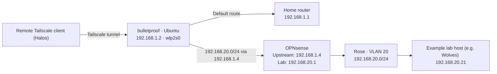

# Home network

> 192.168.1.0/24

## DHCP reservation

> This table has ranges for IPs that have been taken out of the automatic DHCP pool.

|Range|Purpose|
|---|---|
|`.1`|Router|
|`.2–.9`|Infrastructure and services|
|`.10–.19`|Personal devices|

### Allocated

|Network (IP) Address|Hostname|Hardware|
|---|---|---|
|.2|Bulletproof|Lenovo Ideapad 100s|
|.10|Halos|MacBook Pro 16" (M1 Max)|
|.11|Venom|Custom PC|

## Restrictions

> Because my ISP-provided router does not support VLAN creation, as well as the fact that project rose is in its early stages as of 2026-10-26 19:58, there are no layered protections and the network is considerably flatter than it probably ought to be.

### Current protections

- FW rule for blocking LAN → WAN (not internet-restricting)
    
    - This is to prevent any management interfaces from being interacted with from the Rose network (e.g. router and switch management page).
        
- Separate IoT network
    
    - A symptom of activating the 6GHz band, but works great anyway.
        

> More complex isolation will likely be introduced if my intentions for this home lab necessitate it (e.g. malware analysis).

# Rose Network

  

## Rose network categories

|Address/range|Purpose|Example|
|---|---|---|
|`.1`|Gateway/firewall|OPNsense LAN|
|`.2–.9`|Network infrastructure and existing exceptions|Something like a reverse proxy for services if done.|
|`.10–.19`|Dedicated administration devices|Future lab administration workstation|
|`.20–.29`|Hypervisor management|Wolves at `.20`; other Proxmox hosts as deployed|
|`.30–.39`|Shared infrastructure services|DNS, reverse proxy, remote-access gateway|
|`.40–.59`|Self-hosted applications|Forgejo, Wiki.js, dashboards|
|`.60–.79`|Monitoring and security infrastructure|Monitoring server, log collector, SIEM|
|`.80–.99`|Temporary builds and benign experiments|Test Linux VMs|
|`.100–.199`|Automatic DHCP pool|Ordinary clients and temporary devices|
|`.200–.254`|Unallocated expansion|Leave unused initially|

### Allocated

|Network (IP) Address|Hostname|Hardware|
|---|---|---|
|.4|Kisses|ThinkCentre M710q Tiny|
|.20|Wolves|Bosgame P4 Plus mini PC|
|.21|Beers|ThinkCentre M70q Tiny (11DU)|
|.22|Oceans|ThinkCentre 720s (SFF)|
|.23|Doldrums|Acer Aspire TC-885|

## Hardware on M710q | Kisses | OPNsense

> The Lenovo M710q Tiny is the lab's firewall and router, running OPNsense on bare metal for no overhead. Both the lack of intention with the particular machine and its resource limitations (for now) are the reasons why this is not virtualized. The home router will continue to stay as the household router. OPNsense's WAN side sits on the household network, and the lab networks sit behind it as its LAN.

### Hardware

- i5-7400T, 4 GB RAM, WD SN720 256 GB NVMe.
    
- One Ethernet port, an Intel I219-V. The M.2 2230 Wi-Fi slot is there and the rear punch-outs are present.
    
- **A second NIC is possible and I'm not buying one yet.** I'd only do it if sharing a wire turns out to bother me or cause a problem.
    
    - [saltyhashes on reddit](https://opnsenselab.com/posts/opnsense-initial-setup-guide/):
        
        - "the m710q doesn't have a pci-e slot to add a regular network card like its successor, the m720q, so i had to get a bit creative. turns out there's m.2 a+e intel nics that can replace the wifi card and fit just about perfectly into the accessory port punchout."
            
        - [https://www.amazon.com/dp/b0bffrxfxh](https://www.amazon.com/dp/b0bffrxfxh) — this is the solution NIC that worked for them.
            
    - [OPNsenseLab Editorial](https://opnsenselab.com/posts/opnsense-initial-setup-guide/):
        
        - "prefer Intel NICs (igb/em drivers) over Realtek — the Realtek FreeBSD drivers have historically been less reliable under load"
            

### "Risks" and "Open items" for OPNsense node

- **One NIC means router on a stick.** WAN and the tagged lab VLANs share one cable to the TL-SG108E, so the switch's VLAN settings become part of the security boundary. Every switch change needs a test, and no lab VLAN should reach the switch's management page.
    
- **4 GB of RAM** is plenty for routing. If I add Suricata or other packages, I need to recheck, but more than likely it will be a no-go on that end.
    

### Extra notes

> I want the household to keep working when the lab is off. A separate box means the home router never depends on a lab machine.

> I picked OPNsense over pfSense for the amount of community support, the guides, and the available training. Both are FreeBSD, so I expect the skills to carry either way. Discussions on Reddit have swayed me in that pfSense is limiting its software both in regard to its source and in terms of slower updates and hardware support.

## Remote management

Ideapad running Ubuntu Server has Tailscale running on it. It is functioning as a [subnet router](https://tailscale.com/docs/features/subnet-routers), advertising nodes in the rose network for remote access and management, it lives in the home network, it needed a static route in order to properly serve as a subnet router.

